# The Physics Family Tree

**Who trained whom, where they moved, and who got recognized: 11,931 physicists from Wikidata, rebuilt as a knowledge graph, seven models and an interactive archive.**

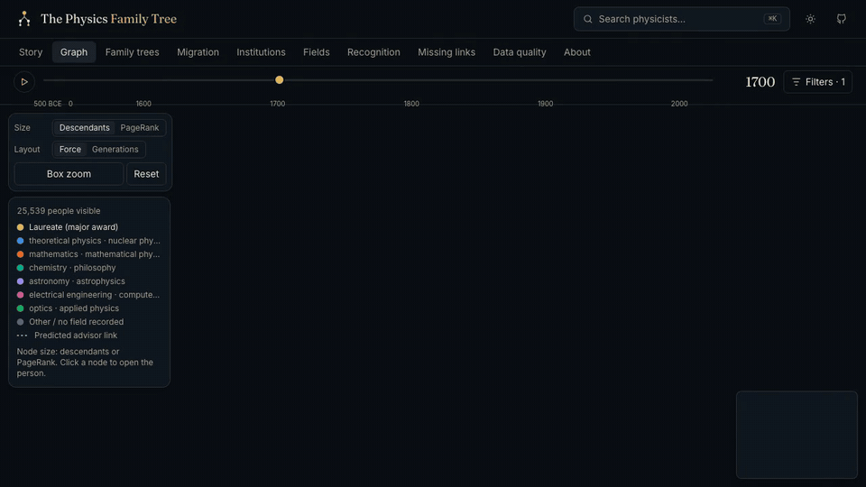

**Live demo:** _(add the GitHub Pages URL after the first deploy)_ · [Model report](models/REPORT.md) · [Decisions log](docs/DECISIONS.md)

---

## Key findings

All numbers come from `models/REPORT.md`, which the code generates from Wikidata as fetched on 2026‑11‑25.

1. **A third of physics Nobel laureates descend from one 17th‑century Leipzig philosopher.** 74 of the 226 Nobel Prize in Physics laureates in the graph (44% of the 170 with any recorded advisor) are academic descendants of Friedrich Leibnütz (1597–1652). His recorded tree has 7,656 descendants across up to 26 generations.
2. **A laureate advisor roughly triples your odds of a major award.** 29.3% of physicists with a laureate advisor won a major award, against 9.2% of everyone else. Adjusted for country, cohort, field, gender and institution, a Cox model still gives a hazard ratio of **1.48** (95% CI 1.27–1.73). The held‑out C‑index is 0.769 for Cox and 0.771 for a random survival forest.
3. **The post‑Soviet brain drain is the sharpest migration shock in the data.** Among people born in former Soviet republics who started a job in 1991–2010, **76%** took it abroad, against 40% in 1960–1990. That jump is larger than the one for 1933–45 Central Europe (57% against 45%).
4. **Women were recognized less than half as often.** 4.2% of women in the cohort won a major award, against 13.0% of men or people with no recorded gender (adjusted HR **0.56**, CI 0.42–0.74).
5. **Missing advisor links can be predicted.** node2vec plus logistic regression scores **AUC 0.927 / AP 0.894** on held‑out links. On an independent check, using Wikidata's "student of" statements, which the model never saw, it ranks the recorded teacher **#1 for 34%** of students against a ~3% chance baseline.

And one lesson about the data: **17% of Wikidata's "physicists" (2,032 people) show no physics signal at all.** Ten are fictional, including Lex Luthor, Doc Brown, Gordon Freeman and Jára Cimrman.

## What's inside

| View | What it shows |
|---|---|
| **Story** | Six scroll steps on one canvas: dataset → lineages → migration → recognition → gaps |
| **Graph** | 25,539 people with a precomputed ForceAtlas2 layout (WebGL/Sigma), coloured by field community, plus a time slider, box‑zoom, minimap and force/generations layouts |
| **Family trees** | Founder leaderboard (yield smoothed toward the base rate), radial or horizontal descendant trees, and a shortest‑path finder |
| **Migration** | Birthplace → employer great‑circle arcs (deck.gl), a Sankey by era, and annotated 1933–45 and post‑1991 shocks |
| **Institutions** | Bump chart of eigenvector centrality by decade: Göttingen, then Harvard from the 1930s |
| **Fields** | Leiden communities of co‑listed fields across 25‑year cohorts (alluvial) |
| **Recognition** | Kaplan–Meier curves by group and a forest plot of Cox hazard ratios |
| **Missing links** | The top 200 predicted advisors, with evidence and Wikidata links |
| **Data quality** | Rule hits and isolation‑forest outliers, ranked, with CSV export |
| **Ask the graph** | Natural language → read‑only Cypher over Kùzu. Appears only when the API is running |

Every chart has PNG/CSV export and an accessible data table. Filters and the time slider live in the URL, so every view is a shareable link. Supports dark and light themes, `prefers-reduced-motion` and keyboard navigation. On phones the graph becomes a searchable list.

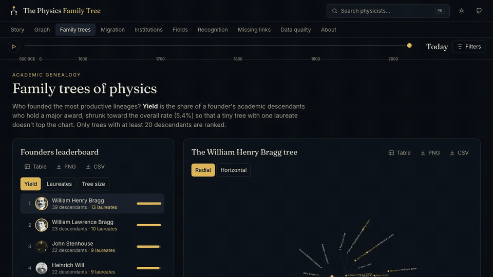

## Screenshots

| | |
|---|---|
| [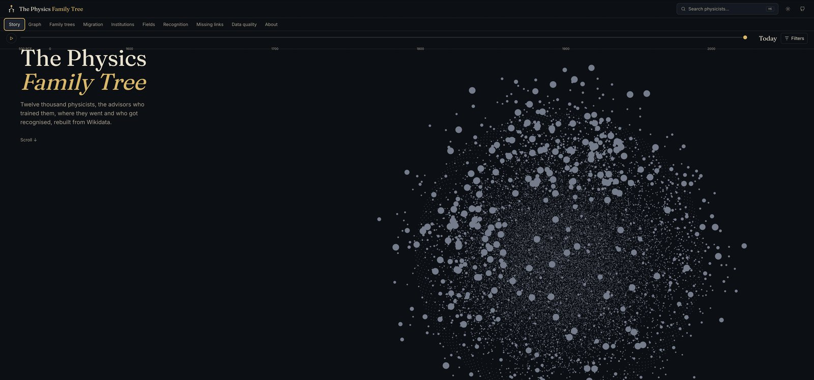](docs/screenshots/story.jpg)<br/>**Story:** 11,931 physicists, one dot each, before the scroll narrative begins | [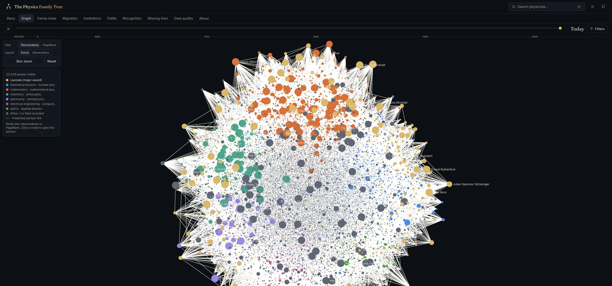](docs/screenshots/graph.jpg)<br/>**Graph:** all 25,539 people coloured by field community, with laureates in gold |
| [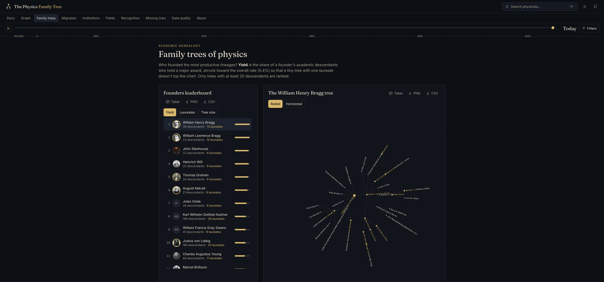](docs/screenshots/family-trees.jpg)<br/>**Family trees:** founders ranked by smoothed laureate yield; William Henry Bragg's tree has 13 laureates among 39 descendants | [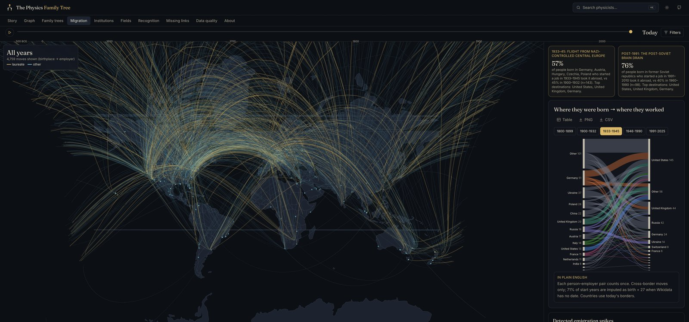](docs/screenshots/migration.jpg)<br/>**Migration:** 4,759 birthplace → employer arcs, with a Sankey of 1933–45 flows and the two migration shocks |
| [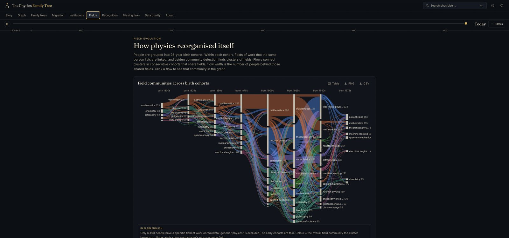](docs/screenshots/fields.jpg)<br/>**Fields:** Leiden field communities flowing across 25‑year birth cohorts | [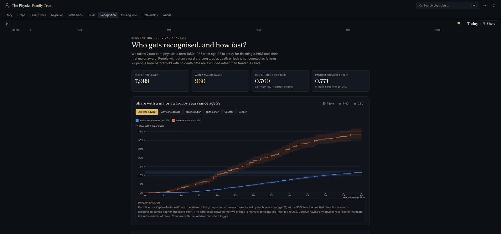](docs/screenshots/recognition.jpg)<br/>**Recognition:** Kaplan–Meier curves; a laureate advisor goes with ~3× the award rate |
| [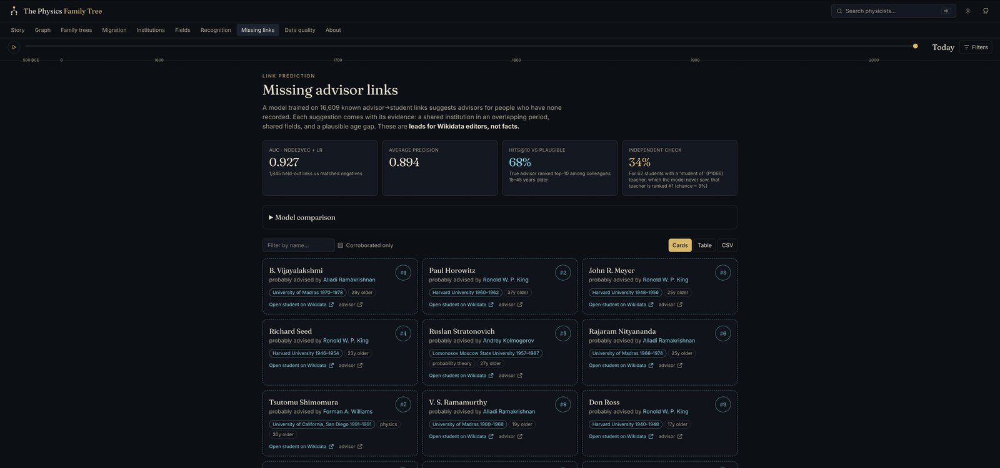](docs/screenshots/missing-links.jpg)<br/>**Missing links:** predicted advisors with evidence (AUC 0.927; 34% top‑1 on the independent check) | [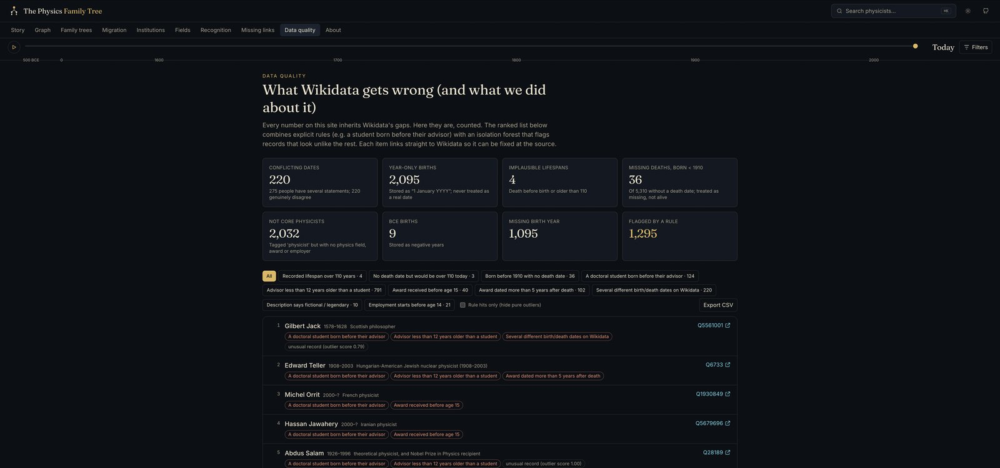](docs/screenshots/data-quality.jpg)<br/>**Data quality:** what Wikidata gets wrong, counted and ranked, with links back to fix it |
| [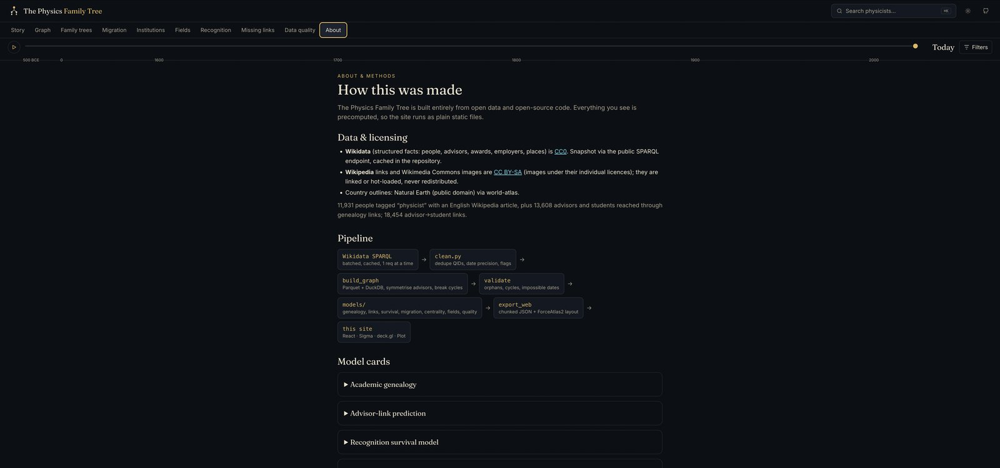](docs/screenshots/about.jpg)<br/>**About:** data licensing, the pipeline and model cards | |

## Architecture

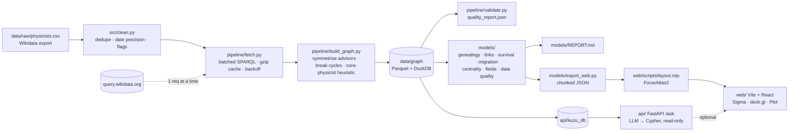

## Quickstart

```bash
make setup            # Python 3.11 venv (uv) + npm ci
make all              # data → models → web build, entirely from the committed cache
cd web && npm run preview   # http://localhost:4173
```

- `make data` resumes from `data/cache/`. `OFFLINE=1` turns any cache miss into an error. To refresh from Wikidata, delete the cache and set `REPO_URL` so the User‑Agent identifies you.
- `make test` runs pytest (30) and Vitest (42). `make e2e` runs Playwright (one smoke test per route, plus search, filters and mobile). `make lint` runs ruff, black, eslint and prettier.
- `make media` re‑records the GIFs/MP4s in `docs/media/`. Set `FFMPEG=` if your system ffmpeg is unusable.
- Optional GraphSAGE comparison: `uv pip install -p .venv -r requirements-ml.txt`.

### Ask the graph (optional)

```bash
export ANTHROPIC_API_KEY=...     # never committed; MODEL defaults to claude-opus-5-5
make api                         # builds Kùzu, serves FastAPI on :8000
cd web && VITE_ASK_API=http://localhost:8000 npm run build && npm run preview
make api-eval                    # 30-question eval vs DuckDB ground truth
```

Guardrails: the database is opened read‑only, write and DDL keywords are rejected, a LIMIT is enforced, there's an 8 s timeout, and a failed query is retried once with the error fed back. `make api-eval-oracle` runs the gold Cypher instead of the LLM and checks the Kùzu load against DuckDB. It currently scores 30/30. The LLM eval has **not been run yet**, because no API key was available while building.

## Data‑quality lessons

- **"1 January YYYY" usually means "we only know the year".** 2,095 births are stored this way. We keep them as year precision and never treat them as real dates.
- **SPARQL joins multiply rows.** 275 people appear on several rows, but only 220 have dates that genuinely disagree.
- **Missing isn't alive.** 36 people born before 1910 have no death date. The survival model excludes them instead of treating them as censored.
- **Advisor links are one‑sided and leaky.** The P184/P185 directions are merged into one edge. One cycle was broken, and 27,900 links that point past the fetched horizon were dropped. One "advisor" turned out to be the concept *physics* itself (Q413, via "student of: physics").
- **Borders move.** "Born in Russia, worked in the Russian Empire" isn't emigration, so historical states are mapped to today's countries.
- **Labels aren't what you expect.** The Dirac Medal is "ICTP Dirac Medal"; J. J. Thomson is "Joseph John Thomson". The major‑award list is audited against the actual labels.

## Licensing

Code: MIT. Data: Wikidata (CC0). Wikipedia links and Commons thumbnails are CC BY‑SA or their own licences, and are linked rather than redistributed. Country outlines: Natural Earth (public domain).

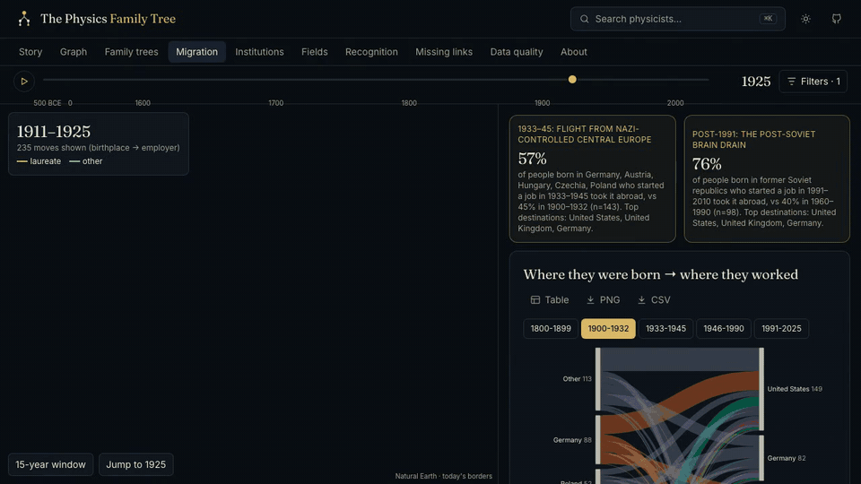
